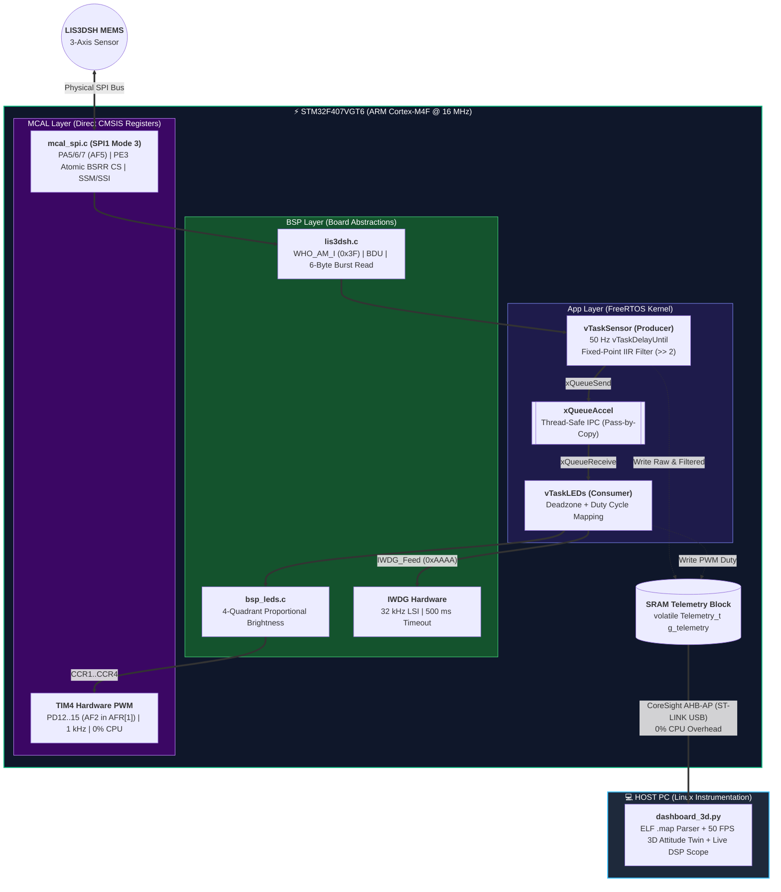

# Bare-Metal STM32F407 3-Axis Inertial Attitude System, Hardware PWM & CoreSight 3D Telemetry

-blue)
-success)

A deterministic, layered embedded firmware system engineered **from scratch without STM32 HAL/LL libraries** on the **STM32F407G-DISC1** (ARM Cortex-M4F). The system acquires 3-axis MEMS inertial data over a register-level SPI driver, filters mechanical noise via fixed-point DSP inside a FreeRTOS producer-consumer pipeline, drives 4-quadrant proportional hardware PWM indicators with 0% CPU load, and streams real-time telemetry to a 3D Digital Twin & DSP Oscilloscope over the ARM CoreSight debug bus without halting the CPU.

---

## Live Demonstration (Hardware + Real-Time 3D Digital Twin & DSP Scope)

> 👆 **Click the image above to watch the hardware demonstration and real-time CoreSight telemetry on YouTube:** [https://youtu.be/j0DCT61kyJc](https://youtu.be/j0DCT61kyJc)

---

## Key Engineering Highlights

* **Zero-HAL Layered Architecture (`MCAL` / `BSP` / `App`):** Strict hardware decoupling following industrial embedded standards. All peripherals (`RCC`, `GPIO`, `SPI1`, `TIM4`, `IWDG`, `NVIC`) are configured via direct CMSIS register manipulation.
* **Register-Level SPI1 Driver & 6-Byte Burst Read:**
  * Configured in **SPI Mode 3 (`CPOL=1, CPHA=1`)** with Software Slave Management (`SSM=1, SSI=1`) to prevent Master Mode Fault (`MODF`) bus lockups.
  * Performs hardware identity verification (`WHO_AM_I == 0x3F`), enables **Block Data Update (`BDU`)** to prevent high/low byte tearing, and utilizes address auto-increment (`ADD_INC`) to execute atomic **6-byte SPI burst reads** (`X, Y, Z` axes in a single Chip Select transaction).
* **Deterministic FreeRTOS Pipeline & Fixed-Point IIR DSP:**
  * **Producer Task (`vTaskSensor`):** Executes at a strict, jitter-free **50 Hz (`20 ms`)** cadence using `vTaskDelayUntil()`. Implements a first-order **Exponential Moving Average (IIR) low-pass filter** in 32-bit fixed-point arithmetic using single-cycle bit shifts (`>> 2`), completely avoiding floating-point unit (FPU) overhead:
    $$y[n] = \frac{3 \cdot y[n-1] + x[n]}{4} \equiv \texttt{(filt * 3 + raw) >> 2}$$
  * **Consumer Task (`vTaskLEDs`):** Blocks indefinitely (`portMAX_DELAY`, **0% CPU load**) waiting on a thread-safe pass-by-copy FreeRTOS Queue (`xQueueAccel`).
* **Zero-CPU Hardware PWM Actuation (`TIM4`):**
  * Multiplexes pins `PD12–PD15` to `TIM4_CH1–CH4` (`AF2` via `GPIOD->AFR[1]`).
  * Configured with a `1 MHz` counter clock (`PSC = 15`) and `ARR = 999` (`1 kHz` PWM frequency), dynamically updating capture/compare registers (`CCR1–CCR4`) proportionally to the tilt angle outside a configurable deadzone.
* **Fault-Tolerant Silicon Watchdog (`IWDG`):**
  * Clocked by the independent `32 kHz` LSI hardware oscillator (`500 ms` timeout). Refreshed exclusively at the end of the consumer task to guarantee automated MCU recovery upon SPI bus stalls or task starvation.
* **Non-Intrusive ARM CoreSight AHB-AP Live Telemetry:**
  * Parses the linker-generated ELF memory map (`.map`) to locate the `volatile Telemetry_t g_telemetry` SRAM structure at runtime.
  * Reads 20-byte telemetry frames directly from SRAM through the Cortex-M4 AHB-AP debug port via OpenOCD + ST-LINK while the CPU runs at full speed (0 CPU cycle overhead), driving a 50 FPS 3D board model and live raw-vs-filtered DSP oscilloscope.

---

## System Architecture

